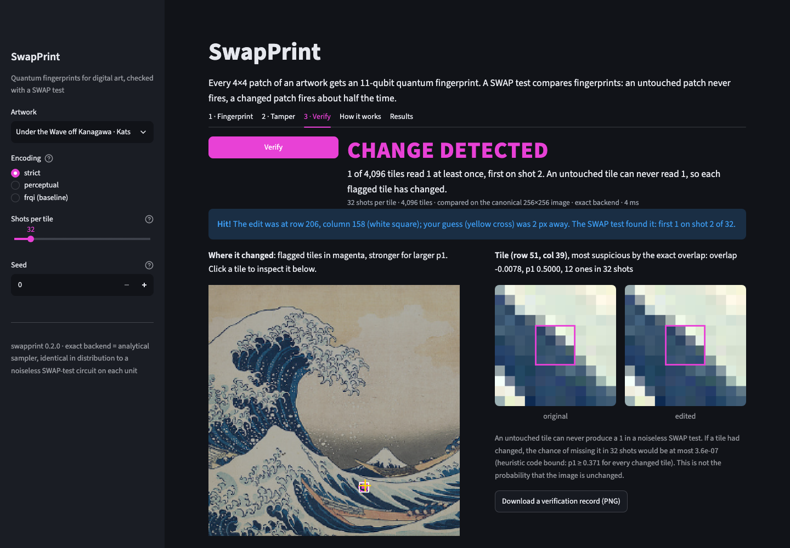
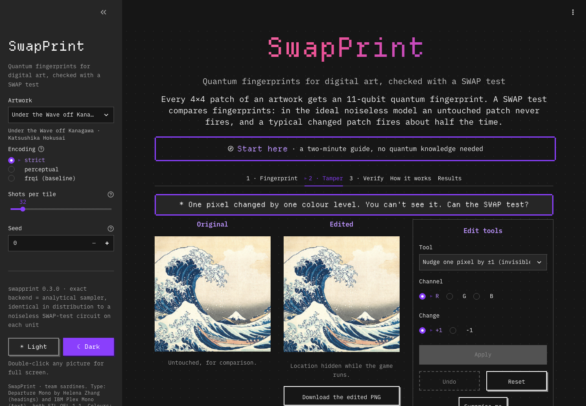
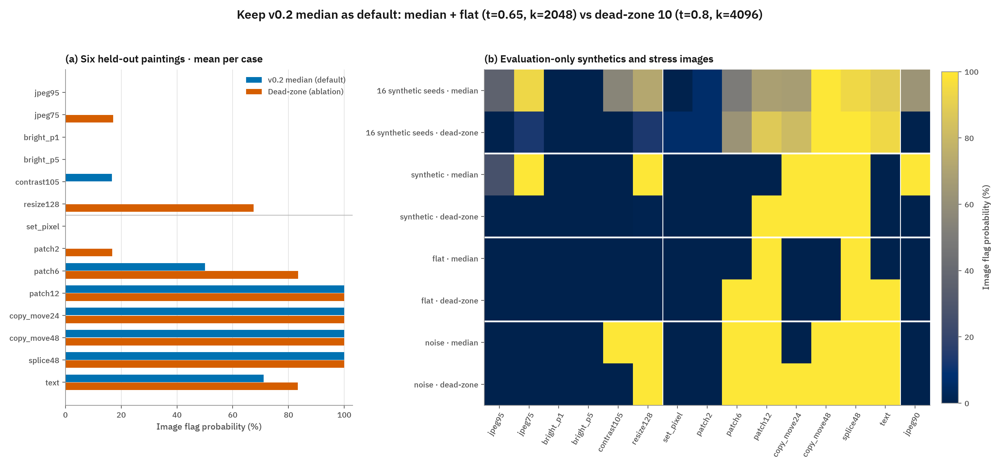
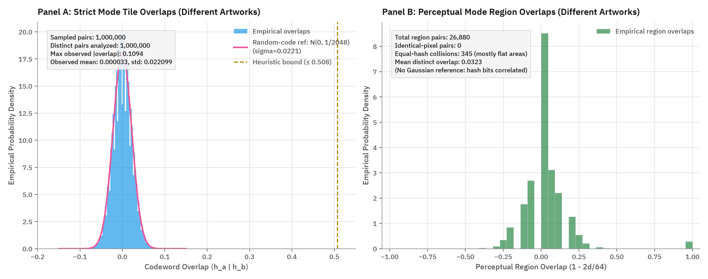
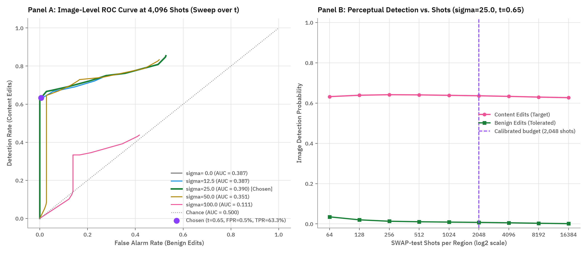
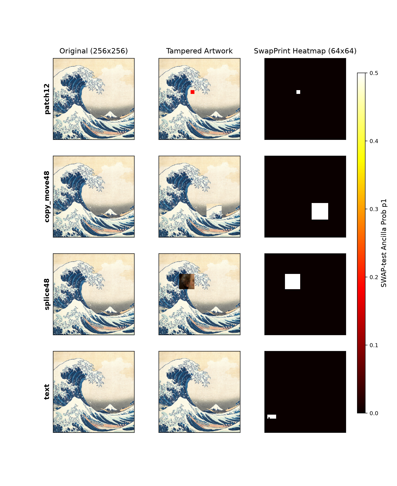

# SwapPrint · Quantum Fingerprinting for Creative Integrity and Tamper Detection

**IBM Qiskit Fall Fest 2026 · BITS Pilani K.K. Birla Goa Campus**  
**Track:** Beginner Track · **Problem 5:** *Quantum Fingerprint: creative integrity and tamper detection*  
**Team:** **sardines** · **Team Code:** `TEAM-P6GK23`  

---

> **One-line pitch:** Can a quantum experiment tell you whether a piece of digital art has been changed? We encode 4×4 image tiles into 11-qubit sign states using Buhrman et al.'s error-correcting code, flag single-pixel changes in a median budget of 7 shots with SWAP tests, and pinpoint altered regions with a tile-by-tile heatmap.

---

## Team

| Name | GitHub | Role & Ownership |
|---|---|---|
| **Rashida Baldiwala** *(Team Leader)* | [@rsb17](https://github.com/rsb17) | Tampering experiment harness, statistical calibration, submission README, demo script |
| **Ansh Varma** | [@aviate15](https://github.com/aviate15) | Interactive Streamlit app, UI/UX, Spot-the-Edit game, Aer integration, demo video |
| **Darshan Prakash Rajagoli** | [@darshanrajagoli](https://github.com/darshanrajagoli) | Quantum core (`swapprint`), circuit transpilation, FakeFez noise study, mathematical theory |

---

## The Demo

An interactive web application built with Streamlit and styled with the open-source Carbon Design System lets users register artwork fingerprints, apply realistic digital tampering, challenge a friend, run live SWAP tests shot by shot, and execute real 23-qubit circuits on Qiskit Aer.

| Verification Heatmap & Live SWAP Test | Interactive Tampering Studio |
|:---:|:---:|
|  |  |

- **Live Public App:** **[Launch SwapPrint on Streamlit Community Cloud](https://qffbitssardines-withoutthes.streamlit.app/)** *(No installation required; runs in any modern desktop browser)*.
- **Demo Video:** [Watch the Walkthrough Video on Google Drive](https://drive.google.com/file/d/18DblHaZpW1hQR3vbmxkzonuY0GlAkSgy/view?usp=drive_link) *(2:45 walkthrough recorded at 1920×1080 with Carbon title/section/end cards and IBM Plex captions; narration script detailed in [`docs/DEMO_SCRIPT.md`](docs/DEMO_SCRIPT.md) and storyboard in [`app/demo/storyboard_cards.json`](app/demo/storyboard_cards.json))*.
- **Live Local App:** `streamlit run app/streamlit_app.py --server.headless true` (opens at `http://localhost:8501`).

---

## The Idea in 30 Seconds

1. **Encode:** A canonical 256×256 RGB artwork is sliced into 4,096 non-overlapping tiles of 4×4 pixels (384 bits each). Each tile's bits $x$ pass through a public pseudo-random linear $[2048, 384]$ error-correcting code, $E(x) = xG$. The 2048-bit codeword sets the signs of an 11-qubit quantum state:
   $$|h_x\rangle = \frac{1}{\sqrt{2048}}\sum_{i=0}^{2047} (-1)^{E(x)_i} |i\rangle$$
   The code spreads even a single-bit nudge across 955–1080 codeword signs, driving the state overlap with the original tile close to zero.
2. **Compare:** A SWAP test (ancilla-based or destructive) between the registered and candidate states reads 1 with probability $p_1 = (1 - |\langle h_x | h_y \rangle|^2)/2$. In the ideal noiseless model, identical inputs have zero probability of producing a 1; we flag a tile when a 1 is observed. Flagged tiles form an alert heatmap displaying modified 4×4 tiles.
3. **Show & Verify:** We implement this construction end-to-end in Python and Qiskit, benchmark it across 22 conditions on 12 museum paintings and 3 generated stress images, evaluate hardware compilation costs and noise on simulated IBM device models (FakeFez), and expose the workflow in an interactive web application.

---

## Judging Map

How this repository addresses each criterion of Problem 5:

| Criterion (Points) | Where to Look | Key Evidence & Findings |
|---|---|---|
| **Design of the quantum fingerprinting approach** (30) | [Design](#design), [Encodings and Measurement](#encodings-and-measurement), [`docs/THEORY.md`](docs/THEORY.md) | Buhrman et al. (PRL 2001) $[2048, 384]$ random linear code construction; both ancilla ($2q+1$) and destructive ($2q$) SWAP tests implemented; exact state overlaps $1 - 2d/2048$; empirical overlap distributions in Figure F3 support the heuristic bound (among 1,000,000 sampled distinct-content strict tile pairs, maximum absolute overlap was 0.1084, against the 0.508 bound). |
| **Tampering experiment and evaluation** (25) | [Tampering Experiment and Evaluation](#tampering-experiment-and-evaluation), Figures F1–F5, Table T1, [`experiments/`](experiments/) | 12 museum paintings and 3 generated stress images (`SOURCES.md`); 22 conditions (one control and 21 non-control cases); 990 image pairs; 69,300 empirical trials; exact probabilities vs Wilson 95% CIs; bootstrap over artworks; zero false alarms on control images; for the tested one-channel edits, the median exact budget for 99% detection across six held-out paintings is 7 shots. |
| **Understanding of encoding and measurement** (20) | [Encodings and Measurement](#encodings-and-measurement), [Noise and Hardware](#noise-and-hardware), Figure F2, Figure F6 | Mathematical comparison of 3 encodings: Strict (11-qubit codewords), Perceptual (6-qubit DCT pHash), and FRQI baseline (7-qubit angles); explains why FRQI needs $\approx 15.5$ million shots for a 1-pixel edit ($p_1 \approx 2.96\times 10^{-7}$) while Strict needs 7 ($p_1 \approx 0.5$); compilation cost analysis (4,180 two-qubit gates all-to-all; 10,129 on FakeFez); FakeFez noise study ($q=1\text{--}3$). |
| **Creativity and usability** (15) | [The Interactive App](#the-interactive-app), `app/`, [`docs/DEMO_SCRIPT.md`](docs/DEMO_SCRIPT.md) | Full Streamlit app with 3 tabs + How It Works + Results styled with Carbon Design System; Spot-the-Edit interactive game; live shot-by-shot SWAP test player; Qiskit Aer circuit execution; downloadable unsigned verification record PNG; responsive UI. |
| **Limitations and clarity** (10) | [Limitations, Stated Honestly](#limitations-stated-honestly), Table T1 | 13 explicit, unvarnished limitations: classical SHA-256 baseline runs in 6.69 ms and is better in practice; simulation offers no quantum advantage; no-cloning theorem consumes state copies; NISQ depth limits prevent 11-qubit execution on physical QPUs; union bound is heuristic. |

---

## Design

SwapPrint partitions each 256×256 RGB image into a grid of 64×64 = 4,096 non-overlapping tiles of 4×4 pixels. Each tile contains $4 \times 4 \times 3 \times 8 = 384$ bits of raw color data. We map this data into quantum states following the quantum fingerprinting protocol of Buhrman, Cleve, Watrous, and de Wolf (*Phys. Rev. Lett.* 87, 167902, 2001):

```
Canonical Image (256×256 RGB)
       │
       ▼
 4,096 Tiles (4×4 px, 384 bits each)
       │
       ▼  xG (Pseudo-random [2048, 384] linear code, seeded by SHAKE-256)
 Codeword c ∈ {0, 1}^2048
       │
       ▼  Sign State Encoding (q = 11 qubits, m = 2048 amplitudes)
 |h_x⟩ = (1/√2048) Σᵢ (-1)^{cᵢ} |i⟩
       │
       ▼  SWAP Test (Ancilla or Destructive) with Candidate |h_y⟩
 Outcome: p₁ = (1 - |⟨h_x|h_y⟩|²) / 2
       │
       ├── p₁ = 0   ──> Untouched tile (never reads 1 in ideal model)
       └── p₁ ≥ 0.37 ──> Tampered tile (flagged at its first 1; shown on alert heatmap)
```

### What the Error-Correcting Code Buys
Without an error-correcting code, flipping 1 bit out of 384 changes only 1 amplitude out of 2048 ($m=2^{11}$), producing an overlap of $1 - 2/2048 = 0.99902$ and a detection probability $p_1 \approx 9.76 \times 10^{-4}$ (requiring thousands of shots).

In SwapPrint, the tile bits $x$ multiply a generator matrix $G \in \mathbb{F}_2^{384 \times 2048}$ expanded deterministically from the public seed `qff-sardines-2026` with SHAKE-256. Because $G$ has full GF(2) rank 384:
- Two distinct tiles *never* produce the same codeword.
- Flipping any single bit in a tile flips between 955 and 1,080 codeword bits (computed exhaustively across all 384 single-bit changes), guaranteeing $p_1 \ge 0.4977$.
- A two-tailed union bound over all $2^{384}-1$ nonzero messages shows that for all but a $10^{-6}$ fraction of random codes, every changed tile has codeword distance $d \in [504, 1544]$, ensuring $|\text{overlap}| \le 0.5078$ and $p_1 \ge 0.3711$.
- At 15 shots per tile, the probability of missing an altered tile is at most $10^{-3}$; at 30 shots, a heuristic upper bound of $10^{-6}$ on P(no detection | changed). At SwapPrint's default budget of 32 shots, the heuristic miss bound is approximately $3.6 \times 10^{-7}$.

Because our generator matrix $G$ is one fixed instance derived from SHAKE-256, this bound is a **heuristic**. Among 1,000,000 sampled distinct-content strict tile pairs, maximum absolute overlap was 0.1083984375; no identical-content pairs were set aside. This supports, but does not certify, the fixed-code heuristic. Perceptual hashes matched for 345/26,880 distinct-content pairs: 1.283% (95% Wilson interval: 1.156%–1.425%). Source: `experiments/figures/collisions.csv`.

### What the Verdict Means
By default, `compare()` runs 32 shots per tile:
- **`TAMPERED` (`CHANGE DETECTED`):** At least one tile's SWAP test returned a 1-measurement. In the ideal noiseless model, identical inputs have zero probability of producing a 1; we flag a tile when a 1 is observed.
- **`NO CHANGE DETECTED`:** No change was detected. Under the random-code heuristic for our fixed SHAKE-256 matrix, P(no detection | changed) is at most approximately $3.6 \times 10^{-7}$ at 32 shots. This is not proof of equality or P(unchanged | no detection).

### Two Execution Backends
1. **`backend="exact"` (Analytical Sampler):** Computes each tile's overlap $|\langle h_x | h_y \rangle|$ directly from the codewords and samples the SWAP test outcomes from $\text{Binomial}(k, p_1)$. This is identical in distribution to an ideal quantum circuit, evaluating the entire 4,096-tile image in under 100 milliseconds. App Verify uses the analytical sampler.
2. **`backend="aer"` (Qiskit Circuit Simulator):** Constructs and executes true 23-qubit Qiskit circuits (for ancilla SWAP tests) or 22-qubit circuits (for destructive SWAP tests) using state-preparation diagonal gates and Aer simulation. The app's Aer button separately executes one classically selected unit. Library `compare(backend="aer")` executes selected traced units—four by default—and samples the remainder analytically, making it a hybrid demonstration.

---

## Encodings and Measurement

The same SWAP test engine supports three distinct encodings, reflecting three different definitions of "integrity":

| Mode | Target Unit | Qubits | Encoding Mechanism | State Overlap | Flagging Condition |
|---|---|---|---|---|---|
| **`strict`** | 4×4 tile (4,096 units) | 11 | Codeword of $[2048, 384]$ linear code | $1 - 2d/2048$ | Any shot reads 1 (default 32 shots) |
| **`perceptual`** | 64×64 region (16 units) | 6 | 64-bit median DCT hash (flat cut-off 25) | $1 - d/32$ | Estimated overlap$^2 < 0.65$ (2,048 shots) |
| **`frqi`** *(Baseline)* | 4×4 tile (4,096 units) | 7 | Normalized RGB pixel angles | $\frac{1}{64}\sum_{i=0}^{63} \cos(\theta_i - \theta'_i)$ | Any shot reads 1 (default 32 shots) |

```
                       Shots Needed for 99% Detection (1-Pixel Tamper)
Mode
─────────────────────────────────────────────────────────────────────────────────
Strict        █████ (7-shot budget across held-out paintings)
Perceptual    [Detects Coarse DCT Changes; Preserved Threshold Bits Evade]
FRQI          ██████████████████████████████████████████████████████ (15.5M shots)
─────────────────────────────────────────────────────────────────────────────────
```

### 1. Strict Mode: Probabilistic Sensitivity to Pixel Changes
Strict mode offers probabilistic sensitivity to canonical pixel changes, down to one bit. For the tested one-channel edits, the median exact budget for 99% detection across six held-out paintings is **seven shots** (`experiments/results/tamper_pairs.csv`).

### 2. Perceptual Mode: Robustness to Benign Re-encoding
Perceptual mode remains the v0.2 median rule at E3 settings: compare the 63 AC coefficients in the top-left 8×8 DCT block strictly above their median, fix bit 0 at zero, and zero the entire hash when AC RMS is below 25. At $t=0.65$ and 2048 shots, flag a region at 359 ones.
- Small edits can pass by design. Perceptual mode detects changes to a coarse DCT hash. Edits preserving its retained threshold bits can evade detection; small text on some paintings is missed.
- **Held-Out Evaluation (6 unseen paintings, 84 conditions):**
  - **Benign false-alarm rate:** **2.78%** [95% CI: 0.00%, 8.33%] (JPEG 95, JPEG 75, resize-down-and-up, and brightness changes all yield 0.0% false alarms; mild contrast produces 16.7%).
  - **Content tampering detection rate:** **65.14%** [95% CI: 59.45%, 70.83%]. Splices, 12×12 patches, and copy-moves are detected at **100.0%**. Small text inserts are detected at **71.12%**. 1-pixel and 2×2 nudges are safely ignored (0.0%).
  - $N = 6$ held-out paintings (48 content and 36 benign conditions); intervals use an artwork bootstrap. Source: `experiments/results/perceptual_calibration.json`.

### Ablation: A Dead-Zone Hash
A per-coefficient dead zone removes the flat-region cliff: synthetic stress benign false alarm falls from 37.78% to 0.157%, and mean JPEG 90 false alarm across 16 synthetic seeds from 62.93% to 0.059%. But at its E3-calibrated point (AC floor 10, $t = 0.80$, 4096 shots), held-out painting benign false alarm rises from 2.78% [95% CI 0.00%, 8.33%] to 14.09% [5.84%, 22.37%], while content detection rises from 65.14% [59.45%, 70.83%] to 72.95% [66.74%, 79.18%]. Intervals are 95% artwork bootstrap intervals (2000 resamples, seed 42). This did not generalise, so we kept v0.2 as the default and retained `rule="deadzone"` only as an ablation. Source: `experiments/results/core_perceptual_v3.json` / `.csv`; figure: `experiments/figures/core_perceptual_ablation.png`.

| Perceptual Ablation: Median vs. Dead-Zone Rule |
|:---:|
|  |
| *Figure: Trade-off between synthetic flat cliff elimination and natural painting benign false-alarm rate.* |

### 3. FRQI Baseline: Why Encoding Matters
Flexible Representation of Quantum Images (FRQI) encodes normalized color angles into qubit amplitudes. FRQI overlap is $\frac{1}{64}\sum_{i=0}^{63} \cos(\theta_i-\theta'_i)$, including the padding positions. Changing one channel value by one level gives overlap $\approx 0.999999703552$ and $p_1 \approx 2.964476322 \times 10^{-7}$. The exact closed-form 99%-detection budget is **15,534,513 shots**.

This comparison shows how encoding changes the SWAP test's sensitivity. There is no quantum advantage in our setting; SHA-256 per tile is better in practice. Buhrman et al.'s communication advantage applies in the simultaneous-message model without shared randomness.

### Two Circuit Implementations (Ancilla vs Destructive)
1. **Ancilla SWAP Test ($2q + 1$ qubits):** Standard circuit using 1 ancilla and $q$ controlled-SWAP gates. Validated on Qiskit Aer across 50 unit pairs; 97 of 100 Wilson 95% confidence intervals contain the exact theoretical $p_1$ (67 of the 70 runs with $p_1 > 10^{-3}$; the 3 misses are 2.3σ-scale fluctuations in both directions, as expected for 95% intervals). Source: `experiments/results/core_validation.csv`, Figure F7 (`experiments/figures/core_validation.png`).
2. **Destructive SWAP Test ($2q$ qubits):** Based on Garcia-Escartin & Chamorro-Posada (*Phys. Rev. A* 87, 052330, 2013). Eliminates the ancilla qubit by applying transversal CNOTs and Hadamards followed by Bell-basis measurements. An odd number of singlet outcomes signals a 1. Saves hardware routing overhead while producing identical outcome probabilities.

---

## Tampering Experiment and Evaluation

We conducted an extensive empirical evaluation to measure detection probabilities, shot budgets, false-alarm rates, and localization accuracy across realistic digital art manipulations.

### Dataset
12 museum paintings and three generated stress images standardizing creative integrity checks, categorized into three distinct splits (documented in [`data/artworks/SOURCES.md`](data/artworks/SOURCES.md)):
- **Calibration split (6 paintings):** Hokusai's *The Great Wave*, Van Gogh's *Straw Hat* and *Wheat Field*, Seurat's *La Grande Jatte*, Hiroshige's *Plum Estate*, Rembrandt's *Self-Portrait*.
- **Held-out test split (6 paintings):** Van Gogh's *Bedroom in Arles*, Monet's *Water Lilies*, Caillebotte's *Paris Street; Rainy Day*, Hiroshige's *Sudden Shower over Shin-Ōhashi*, Vermeer's *Young Woman with a Water Pitcher*, Turner's *The Grand Canal, Venice*.
- **Stress-test split (3 images):** `synthetic` (procedural color patterns), `flat` (pure white canvas), `noise` (pseudo-random Gaussian noise).

### Tamper Matrix (22 Conditions)
Every artwork was evaluated across 22 conditions: one unchanged control and 21 non-control cases:
1. **Control (1 case):** `identity` (unaltered image).
2. **Imperceptible edits (6 cases):** `pixel_1` through `pixel_5`, each a single-channel $\pm 1$ edit at a manifest-selected position, plus `lsb` (payload hidden in bit-plane 0).
3. **Benign image transformations (6 cases):** `jpeg95`, `jpeg75`, `bright_p1`, `bright_p5`, `contrast105`, `resize128` (bilinear downsampling to 128×128 and bilinear upsampling back to 256×256).
4. **Content tampering (8 cases):** `set_pixel` (pixel set to red `(255, 0, 0)`), `patch2` (2×2 red square), `patch6`, `patch12`, `copy_move24` (24×24 region cloned to another position), `copy_move48`, `splice48` (48×48 donor patch spliced from another artwork), `text` ("FAKE" rendered using Pillow's default font).
5. **Collision check (1 case):** `different` (compared against an unrelated artwork in the split).

### Methodology & Statistics
- 15 artworks × 22 conditions × 3 modes = 990 image pairs evaluated.
- Ten replicates were sampled at nine budgets for strict and FRQI: $\{1, 2, 4, 8, 16, 32, 64, 128, 256\}$; perceptual used $\{256, 1024, 4096\}$. This gives 29,700 strict, 29,700 FRQI and 9,900 perceptual trials: **69,300 total evaluated trials** (`experiments/results/tamper_trials.csv`).
- Uncertainty handled rigorously: analytical probabilities labeled exact; empirical sampling rates assigned **Wilson 95% confidence intervals**; aggregate metrics over artworks reported with non-parametric **bootstrap 95% confidence intervals**.

---

### Empirical Findings: Figures F1–F5

| Figure | Summary Visualization | Key Takeaway |
|---|:---:|---|
| **F1: Detection vs Shots** |  | In strict mode, analytical curves and empirical trials match precisely (within Wilson 95% intervals). At eight shots, the five single-pixel cases produced 744/750 detections: 99.20% (95% Wilson interval: 98.27%–99.63%). Strict controls produced 0/1,350 false alarms (95% Wilson interval: 0%–0.284%); the ideal identical-input false-alarm probability is exactly zero. |
| **F2: Shots Needed Across Cases** |  | Strict mode detects all 21 tampering cases in $< 32$ shots. Perceptual mode uses the calibrated median hash ($t=0.65$, 2,048 shots). FRQI requires over $10^7$ shots for fine edits, showing that encoding dictates sensitivity. |
| **F3: Collision Distribution** |  | Overlap distribution over $1,000,000$ distinct tile pairs matches the theoretical $\mathcal{N}(0, 1/2048)$ Gaussian. Among 1,000,000 sampled distinct-content strict tile pairs, maximum absolute overlap was 0.1083984375, supporting the heuristic bound. Perceptual hashes matched for 345/26,880 distinct-content pairs (1.283%). |
| **F4: Perceptual ROC Curves** |  | Sweeping threshold $t$ across flatness cutoffs $\sigma$ reveals an optimal operating point at $\sigma = 25.0, t = 0.65$. Constant-colour regions share an all-zero AC hash, so perceptual mode cannot distinguish their colours; strict mode retains that information. |
| **F5: Tamper Localisation** |  | The heatmap displays flagged 4×4 tiles. Finite-shot checks can miss changed tiles; unchanged tiles have exactly zero flag probability in the ideal model. Flagged 4×4 tiles identify modified regions for `patch12`, `copy_move48`, `splice48`, and `text`. |

---

### Table T1: Classical vs. Quantum Fingerprinting Baseline Comparison

All benchmarks performed on a 13th Gen Intel Core i5-13420H (Windows 11) using canonical 256×256 RGB images (192 KiB).

| Method / Mode | Unit / Tile | Qubits | Detects 1-Pixel? | Image Detection (Budget) | False Alarm | Storage per Image | Comparisons | Fingerprint-generation time | Practicality / Hardware Note |
|---|---|---|---|---|---|---|---|---|---|
| **Strict Mode (SwapPrint)** | 4×4 px (4,096 tiles) | 11 | **Yes** (median 7-shot budget for 99% detection) | **3,120/3,120** actual changes detected (100.00%, 95% Wilson: 99.88%–100%) | **0/1,350** observed (0.00%, 95% Wilson: 0%–0.284%); ideal is zero | 1 MiB packed (8 MiB uint8; 1,025.9 KiB `.npz`) | 4,096 × 32 = 131,072 SWAP tests | 76.8 ms | Requires ~4,180 two-qubit gates per tile; beyond NISQ capabilities |
| **Perceptual Mode (SwapPrint)** | 64×64 px (16 regions) | 6 | **No** (deliberately ignored) | **65.14%** content (100% on splices/patches; 2.78% benign FA at 2048 shots) | **0/450** observed (0.00%) | 128 B packed (1 KiB uint8 array; 1.8 KiB `.npz`) | 16 × 2048 = 32,768 SWAP tests | 1.6 ms | Hardware performance at this size was not established; noise experiments use toy states with $q\le3$ |
| **FRQI Baseline (Pixels as Angles)** | 4×4 px (4,096 tiles) | 7 | **No** at 32 shots (needs 15,534,513 shots for 99% detection) | **2,066/3,120** actual changes detected (66.22%, 95% Wilson: 64.54%–67.86%) | **0/1,350** observed (0.00%) | 2 MiB (float64; 260.8 KiB `.npz`) | 4,096 × 32 = 131,072 SWAP tests | 2.3 ms | Uniformly controlled RY gates, deep decomposition |
| **Classical Baseline (SHA-256 per Tile)** | 4×4 px (4,096 tiles) | 0 (Classical) | **Yes** (1 comparison) | **100.0%** (all 21 tested non-control edits produced different digests) | **0.00%** (deterministic equality) | 128 KiB (4,096 × 32 B hashes) | 4,096 classical 32-byte equality checks | **6.69 ms** | **SHA-256 per tile is better in practice; runs natively on CPU** |

---

## Noise and Hardware

### Compilation Costs (Figure F6, Panel 2)
State preparation for an arbitrary $q$-qubit sign state requires a Walsh-Hadamard transform followed by a diagonal unitary with $\pm 1$ eigenvalues, costing about $2^q$ two-qubit gates.
- For F6’s $q=11$ random-near ancilla circuit, the recorded all-to-all compilation has **4,180 two-qubit gates** and depth **4,110**; FakeFez compilation has **10,129 two-qubit gates** and depth **12,112**.
- One preparation has **2,046 gates** all-to-all and **3,757** on FakeFez, with routed depth **11,772**.
- These are compilation results, not QPU executions. Source: `experiments/results/core_gate_costs.csv`.
- **Conclusion:** Full 11-qubit strict fingerprint circuits cannot execute with meaningful fidelity on current NISQ hardware. For this reason, all noisy simulations are conducted as **measurement demonstrations on toy states ($q \le 3$)**.

| Core Noise & Threshold Analysis (FakeFez, $q=1\text{--}3$) | Transpilation & Gate Scaling ($q=1\text{--}11$) |
|:---:|:---:|
|  | *4,180 two-qubit gates all-to-all; 10,129 on FakeFez* |

### Noise Study on Simulated IBM Hardware (FakeFez)
Noise was simulated in Aer using IBM device noise models FakeFez and FakeBrisbane on toy states with $q=1\text{--}3$. No physical IBM Quantum hardware was used.
Both SWAP-test kinds were sampled at 4,000 shots per circuit and transpiler seeds 7, 23 and 91:
1. **Noise lifts identical states off zero:**
   - For the $q=2$ random identical-state ancilla circuit at transpiler seed 23, 216/4,000 outcomes were one: raw $\hat{p}_1=0.0540$ [0.04725, 0.06100]; readout-corrected $\hat{p}_1=0.04975$ [0.04268, 0.05693].
   - These are 95% percentile parametric-bootstrap intervals from 2,000 joint test/calibration resamples, conditional on the simulated model.
   - Readout correction leaves residual circuit error; this experiment does not identify its dominant mechanism. Source: `experiments/results/core_noise.csv` and `core_noise_run.json`.
2. **Consequence:** In the presence of device noise, observing a single 1-measurement is no longer conclusive evidence of tampering. Noisy verification requires setting an empirical decision threshold $\tau$.
3. **Multi-tile false alarm compounding:** Under independent tile decisions, image false-alarm probability is $1-(1-f)^{4096}$. A 1% image target requires $f \le 2.4536923 \times 10^{-6}$; without independence, $f \le 0.01/4096$ is sufficient by the union bound. The threshold table targets $\le 1\%$ false alarm and $\ge 99\%$ power per toy unit using conditional plug-in binomial calculations, not validated image-level guarantees. The image target is extrapolated and unresolved by 4,000 shots.
4. **Physical Hardware Status:** No physical IBM Quantum hardware was used; there is no QPU result or hardware figure to report. IBM dispatch raises `NotImplementedError`.

---

## Limitations, Stated Honestly

To maintain strict scientific integrity, we explicitly detail the limitations of this construction:

1. **Not a signature or watermark:** SwapPrint is an integrity verification test, not a signature or watermark. The generator matrix $G$ is public and injective; a registered fingerprint can be decoded back into the canonical pixel data. It contains no secret keys and does not embed watermarking bits into the canvas.
2. **No advantage in classical simulation:** Simulating quantum fingerprints on a classical computer offers no advantage over classical hashes. Computing state overlaps classically is strictly slower than computing standard cryptographic hashes.
3. **Buhrman et al.'s advantage is model-specific:** The exponential communication advantage ($O(\log n)$ qubits vs $\Theta(\sqrt{n})$ classical bits) proven by Buhrman et al. holds exclusively in the *simultaneous-message passing model without shared randomness*. In our setting, the verifier already possesses a stored reference fingerprint, where classical hashes like SHA-256 achieve $O(1)$ size and $O(n)$ verification.
4. **Fingerprint copies are consumed (No-Cloning Theorem):** Each independent shot needs a fresh copy of both states. A 4,096-tile, 32-shot check uses 131,072 reference states and 131,072 candidate states. Unknown states cannot be cloned; copies must be prepared or supplied. Known classical codewords allow repeated preparation, and copies may be processed sequentially.
5. **Circuit depth exceeds NISQ limits:** Preparing an 11-qubit sign state requires $\sim 2^{11}$ CNOT gates. Compiling onto IBM Heron r2 (`FakeFez`) yields over 10,000 two-qubit gates, far beyond the coherence times and gate fidelities of today's physical QPUs.
6. **Hardware noise breaks the one-sided error guarantee:** On an ideal noiseless simulator, $p_1 = 0$ for identical tiles, making zero-false-alarm verification possible. On a simulated IBM noise model (FakeFez), depolarizing noise produces false 1s ($p_1 > 0$ for identical tiles), forcing the use of statistical thresholds which multiply over 4,096 tiles.
7. **Canonical downsampling defines "same":** Images are canonicalized to 256×256 RGB. Edits made at higher resolutions that disappear during downsampling (e.g., fine sub-pixel adjustments on a 4K canvas) are invisible to SwapPrint by definition.
8. **No secret key:** There is no secret key: anyone can generate fingerprints, and verification depends on a trusted stored reference. Strict codewords are injective and publicly decodable. Perceptual fingerprints can collide and can miss edits that preserve their retained DCT bits.
9. **Perceptual mode requires texture variance:** There is no inconclusive verdict. Constant-colour regions share an all-zero AC hash, so perceptual mode cannot distinguish their colours. Strict mode retains that information.
10. **The collision bound is heuristic:** The union bound proving $|\text{overlap}| \le 0.508$ is derived over the ensemble of all random linear codes. While our specific SHAKE-256 matrix exhibits a measured maximum $|\text{overlap}|$ of $0.1084$, the theoretical guarantee for a single fixed matrix remains heuristic.
11. **"No change detected" is not proof of equality:** No change was detected. Under the random-code heuristic for our fixed SHAKE-256 matrix, P(no detection | changed) is at most approximately $3.6 \times 10^{-7}$ at 32 shots. This is not proof of equality or P(unchanged | no detection).
12. **The Aer app demonstration is a hybrid system:** App Verify uses the analytical sampler. The Aer button separately executes one classically selected unit. Library `compare(backend="aer")` executes selected traced units—four by default—and samples the remainder analytically, making it a hybrid demonstration.
13. **SHA-256 per tile is better in practice:** As shown in Table T1, classical SHA-256 per 4×4 tile hashes an entire 256×256 image in 6.69 ms with 128 KiB storage, detects 100% of tested tampering cases, and has zero false alarms. SwapPrint's contribution is an empirical and mathematical exploration of quantum state encodings and SWAP test measurements, not a practical replacement for classical hashing today.

---

## The Interactive App

An interactive web application built with Streamlit, Plotly, and Qiskit lets users test the system in real time. Styled using the open-source Carbon Design System tokens and typography (`docs/style/carbon.css`).

```bash
# 1. Install dependencies
pip install -r app/requirements.txt

# 2. Launch the Streamlit application
streamlit run app/streamlit_app.py --server.headless true

# 3. Run the automated app test suite
pytest -q app/tests
```
Open `http://localhost:8501` in your browser, or visit the live public deployment directly on **[Streamlit Community Cloud](https://qffbitssardines-withoutthes.streamlit.app/)**.

| App Tab | Capability & Interactive Features |
|---|---|
| **1 · Fingerprint** | View the canonical 256×256 artwork, inspect the math of the $[2048, 384]$ code, and visualize the **Fingerprint Mosaic** (codeword bits mapped to RGB color tiles). Download registered fingerprints as `.npz` files. |
| **2 · Tamper** | Interactive canvas studio: click any coordinate to apply single-pixel nudges, red patches, copy-moves, splices, text insertions, LSB watermarks, or JPEG re-saves. Includes Undo, Reset, a **"Surprise Me"** button that hides an invisible 1-pixel edit for the game, and a **"Challenge a friend"** mode that hides your custom edits so someone else can test their eyes against the quantum verifier. |
| **3 · Verify** | **Spot the Edit:** Guess where the tamper occurred, then run verification. Displays the verdict, total shots evaluated, a 64×64 **tamper heatmap** highlighting altered tiles, a zoomed inspection of the most suspicious tile, and a **Live SWAP Test** visualizer that plays shots one by one with a real-time Wilson interval. Includes **Compare Encodings** (Strict vs Perceptual vs FRQI), a **"Run on Qiskit Aer"** button to execute true 23-qubit circuits, and **Check a file** to verify an image against a registered `.npz` without uploading the original (a strict `.npz` can itself reconstruct the canonical image). |
| **How It Works** | Comprehensive educational walkthrough of the 5-step pipeline, circuit diagrams, mathematical derivations, and honest limitations. |
| **Results** | Interactive gallery displaying all generated figures (F1–F7, ablation, noise) with captions from `captions.json` and `core_captions.json`. |

### How the App Computes, Said Precisely
- **Verify uses the `exact` backend:** each unit's overlap is computed exactly and its SWAP-test outcomes are sampled, identical in distribution to a noiseless circuit on that unit (evaluates in under 2 seconds).
- **"Run on Qiskit Aer" runs a real circuit** for one tile, executed in a separate process. The tile is chosen classically (by the exact overlap or user click), making this a hybrid demonstration rather than a purely quantum verifier.
- **Every number on screen is computed from `swapprint` at runtime**, including the code bound, shot counts, perceptual threshold, and single-bit flip range; none are hardcoded.
- **A fingerprint is not secret:** a strict `.npz` decodes back to the image, and there is no secret key. Anyone can fingerprint anything, so a check only shows consistency with a trusted stored reference. It is an integrity check, not a signature or watermark. "No change detected" is not proof that nothing changed.

### Third-Party Code & Design in the App
- **Libraries:** Streamlit (Apache-2.0), Plotly (MIT), streamlit-image-coordinates (MIT), Pillow (MIT-CMU), Qiskit and Qiskit Aer (Apache-2.0), Playwright (Apache-2.0). Artworks are CC0 / Public Domain from museum collections (`data/artworks/SOURCES.md`).
- **Design & Typography:** Built with tokens from the [Carbon Design System](https://carbondesignsystem.com) (Apache-2.0; tokens from `swapprint/style.py`, CSS in `docs/style/carbon.css`) and typography set in [IBM Plex](https://github.com/IBM/plex) (SIL Open Font License 1.1; fonts located in `app/static/fonts/` with `OFL.txt`). SwapPrint is an independent student project by team sardines and is not made or endorsed by IBM.

---

## Setup and Reproduction

### Prerequisites
- Python 3.11, 3.12, or 3.13.
- Windows, macOS, or Linux. (On Windows, ensure long paths are enabled or clone into a short directory path).

### Installation
```bash
# Clone the repository
git clone https://github.com/darshanrajagoli/qff_bits_sardines.git
cd qff_bits_sardines

# Create and activate virtual environment
python -m venv .venv
source .venv/bin/activate       # On Windows: .venv\Scripts\Activate.ps1

# Install core and app dependencies
pip install -r requirements.txt
pip install -r app/requirements.txt
pip install -e . --no-build-isolation
```

### Quickstart & Test Verification
```bash
# 1. Run the quickstart verification script
python examples/quickstart.py

# 2. Run the core test suite (circuits, encodings, math)
pytest -q -m "not slow"

# 3. Run the app test suite (Streamlit helpers, verdicts)
pytest -q app/tests
```

### Reproducing the Experiments
```bash
# Fast smoke-test reproduction (2 artworks, 5 cases, 3 modes)
python -m experiments.run_tamper --quick

# Full experimental reproduction (15 artworks, 22 cases, 3 modes, 69,300 trials)
python -m experiments.run_tamper

# Run perceptual ablation study (dead-zone vs median)
python experiments/core_perceptual_v3.py

# Regenerate all publication figures (F1–F5) and Table T1
python -m experiments.make_figures
```

---

## Repository Map

```
qff_bits_sardines/
├── README.md                      # Complete submission document (Rashida)
├── requirements.txt               # Quantum core dependencies
├── pyproject.toml                 # Packaging configuration for swapprint v0.3.0
│
├── swapprint/                     # Quantum Core Library (Owner: Darshan)
│   ├── __init__.py                # Top-level API: load_image, fingerprint, compare
│   ├── circuits.py                # 23-qubit Ancilla & 22-qubit Destructive SWAP test circuits
│   ├── codes.py                   # [2048, 384] linear code generator & union bounds
│   ├── compare.py                 # Exact analytical sampler & backend dispatcher
│   ├── encodings.py               # Strict, perceptual (median & deadzone), and FRQI encoders
│   ├── noise.py                   # FakeFez noise study & threshold calibration
│   ├── style.py                   # IBM Carbon style kit & Plex font manager
│   └── validate.py                # Qiskit Aer circuit validation against exact p1
│
├── app/                           # Interactive Web Application (Owner: Ansh)
│   ├── streamlit_app.py           # Multi-tab Streamlit user interface
│   ├── requirements.txt           # App dependencies (Streamlit, Plotly)
│   ├── helpers.py                 # Color conversions, heatmaps, state formatting
│   ├── demo/                      # Automated recording scripts and storyboards
│   ├── screenshots/               # High-resolution screenshots of the UI
│   └── tests/                     # 21 automated unit tests for app behavior
│
├── experiments/                   # Tampering Experiments & Evaluation (Owner: Rashida)
│   ├── fetch_artworks.py          # Museum API ingestion script (CC0 / Public Domain)
│   ├── run_tamper.py              # 22-case tampering harness (69,300 trials)
│   ├── calibrate_perceptual.py    # Perceptual mode hyperparameter grid search
│   ├── core_perceptual_v3.py      # Dead-zone hash ablation study
│   ├── make_figures.py            # Generates F1–F5 and Table T1 (Carbon styled)
│   ├── stats.py                   # Wilson 95% CIs and bootstrap estimators
│   ├── results/                   # Frozen experimental data (tamper_pairs.csv, etc.)
│   └── figures/                   # Rendered publication figures (F1–F7, core_noise.png, ablation)
│
├── data/artworks/                 # Standardized Artwork Dataset (Owner: Rashida)
│   ├── SOURCES.md                 # Full provenance, museum links, and CC0 licenses
│   ├── *.png                      # 12 canonical museum paintings (256×256 RGB)
│   └── [synthetic, flat, noise]   # 3 algorithmic stress-test canvases
│
└── docs/                          # Scientific & Technical Documentation
    ├── THEORY.md                  # Complete mathematical derivations & proofs (Darshan)
    ├── QA.md                      # Comprehensive judge Q&A guide (Darshan)
    ├── DEMO_SCRIPT.md             # 3-minute video presentation script (Rashida)
    ├── README_sections.md         # Quantum core draft sections (Darshan)
    └── style/                     # Carbon design tokens, CSS, and Streamlit config
```

---

## Credits & Acknowledgements

### Open-Source Libraries & Design Assets
- **Qiskit & Qiskit Aer** (Apache-2.0) — Quantum circuit construction, compilation, and noisy simulation.
- **Streamlit** (Apache-2.0) & **Plotly** (MIT) — Interactive web user interface and responsive charts.
- **NumPy & SciPy** (BSD-3-Clause) — High-performance array operations and statistical distributions.
- **Pillow** (HPND) — Deterministic image canonicalization and pixel transformations.
- **Matplotlib** (PSF-based) — Scientific publication figure generation.
- **Carbon Design System** (Apache-2.0, `@carbon/colors`, `@carbon/themes`) — Palette and visual design tokens.
- **IBM Plex** (SIL OFL 1.1) — Typography (IBM Plex Sans, IBM Plex Mono).
- *Disclaimer:* SwapPrint is an independent student project and is not made or endorsed by IBM.

### Image Sources
All artwork images were retrieved from museum open-access collections under Creative Commons Zero (CC0) or Public Domain designations:
- **Art Institute of Chicago (AIC):** Katsushika Hokusai, Vincent van Gogh, Georges Seurat, Gustave Caillebotte.
- **Metropolitan Museum of Art (The Met):** Utagawa Hiroshige, Rembrandt van Rijn, Claude Monet, Johannes Vermeer, J.M.W. Turner.  
Complete URLs, access numbers, and licenses are detailed in [`data/artworks/SOURCES.md`](data/artworks/SOURCES.md).

### References
1. H. Buhrman, R. Cleve, J. Watrous, and R. de Wolf. *Quantum fingerprinting.* Physical Review Letters 87, 167902 (2001). [arXiv:quant-ph/0102001](https://arxiv.org/abs/quant-ph/0102001).
2. J. C. Garcia-Escartin and P. Chamorro-Posada. *SWAP test and Hong-Ou-Mandel effect are equivalent.* Physical Review A 87, 052330 (2013). [arXiv:1303.6814](https://arxiv.org/abs/1303.6814).
3. P. Q. Le, F. Dong, and K. Hirota. *A flexible representation of quantum images for polynomial preparation, image compression, and processing.* Information Sciences 181, 1497–1517 (2011).

### Hackathon Integrity Statement
**Work done before the hackathon:** None. Every line of code, documentation, experiment, and figure in this repository was conceived and written during the hackathon period starting 29 October 2026.

**AI Assistance Disclosure:** Built with help from AI coding assistants (Claude, Codex, Gemini); every design decision, experiment, and number is ours and reproducible from this repository.
