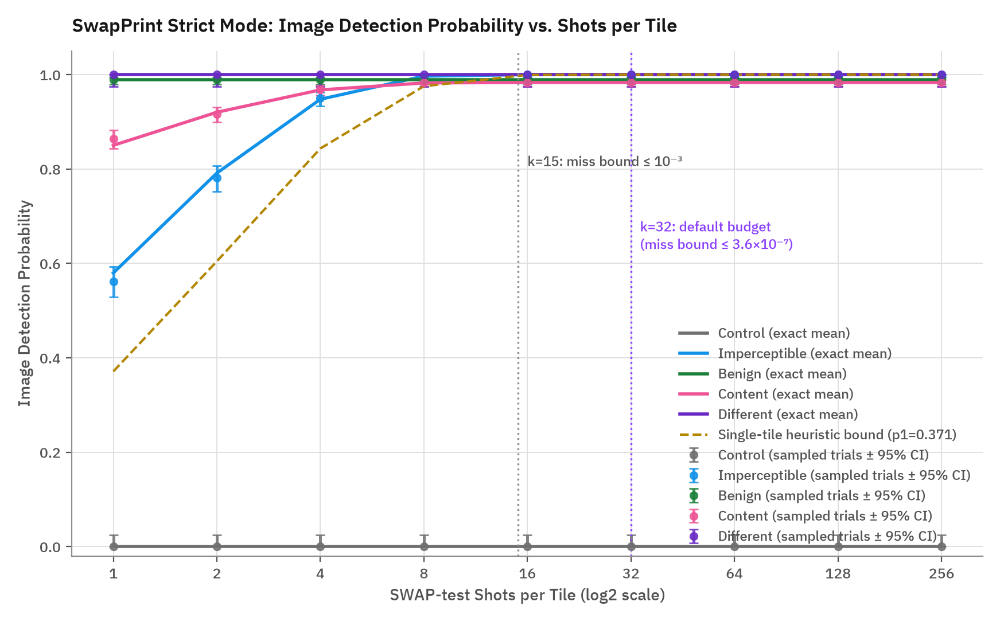
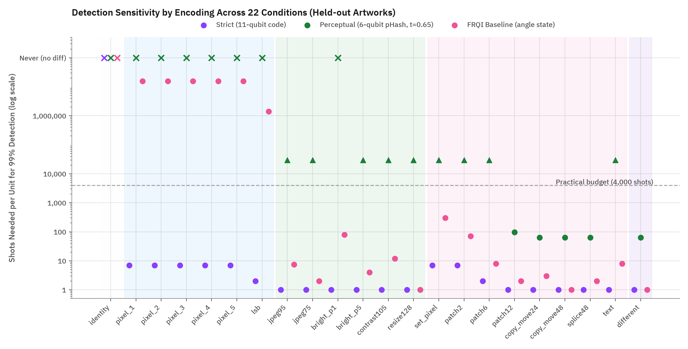
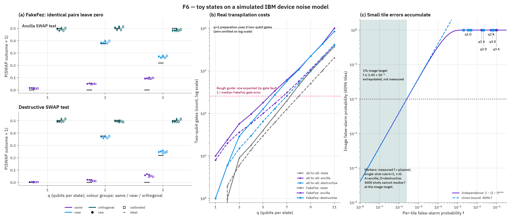

# SwapPrint · Quantum Fingerprinting for Creative Integrity and Tamper Detection

**IBM Qiskit Fall Fest 2026 · BITS Pilani K.K. Birla Goa Campus**  
**Track:** Beginner Track · **Problem 5:** *Quantum Fingerprint: creative integrity and tamper detection*  
**Team:** **sardines** · **Team Code:** `TEAM-P6GK23`  

---

> **One-line pitch:** Can a quantum experiment tell you whether a piece of digital art has been changed? We encode 4×4 image tiles into 11-qubit sign states using Buhrman et al.'s error-correcting code, catch single-pixel tampering in median 7 shots with SWAP tests, and pinpoint altered regions with a tile-by-tile heatmap.

---

## Team

| Name | GitHub | Role & Ownership |
|---|---|---|
| **Rashida Baldiwala** *(Team Leader)* | [@rsb17](https://github.com/rsb17) | Tampering experiment harness, statistical calibration, submission README, demo script |
| **Ansh Varma** | [@aviate15](https://github.com/aviate15) | Interactive Streamlit app, UI/UX, Spot-the-Edit game, Aer integration, demo video |
| **Darshan Prakash Rajagoli** | [@darshanrajagoli](https://github.com/darshanrajagoli) | Quantum core (`swapprint`), circuit transpilation, FakeFez noise study, mathematical theory |

---

## The Demo

An interactive web application lets users register artwork fingerprints, apply realistic digital tampering, run live SWAP tests shot by shot, and execute real 23-qubit circuits on Qiskit Aer.

| Verification Heatmap & Live SWAP Test | Interactive Tampering Studio |
|:---:|:---:|
|  |  |

- **Demo Video:** [Watch the 3-Minute Walkthrough on YouTube](#) *(Video submission recorded by Ansh; narration script detailed in [`docs/DEMO_SCRIPT.md`](docs/DEMO_SCRIPT.md) and storyboard in [`app/demo/storyboard.json`](app/demo/storyboard.json))*.
- **Live Local App:** `streamlit run app/streamlit_app.py --server.headless true` (opens at `http://localhost:8501`).

---

## The Idea in 30 Seconds

1. **Encode:** A canonical 256×256 RGB artwork is sliced into 4,096 non-overlapping tiles of 4×4 pixels (384 bits each). Each tile's bits $x$ pass through a public pseudo-random linear $[2048, 384]$ error-correcting code, $E(x) = xG$. The 2048-bit codeword sets the signs of an 11-qubit quantum state:
   $$|h_x\rangle = \frac{1}{\sqrt{2048}}\sum_{i=0}^{2047} (-1)^{E(x)_i} |i\rangle$$
   The code spreads even a single-bit nudge across ~1,000 codeword signs, driving the state overlap with the original tile close to zero.
2. **Compare:** A SWAP test (ancilla-based or destructive) between the registered and candidate states reads 1 with probability $p_1 = (1 - |\langle h_x | h_y \rangle|^2)/2$. An untouched tile gives $p_1 = 0$ and *never* reads 1 on a noiseless system. A single 1-outcome is definitive proof of alteration. The flagged tiles form an exact tamper heatmap.
3. **Show & Verify:** We implement this construction end-to-end in Python and Qiskit, benchmark it across 22 tampering conditions on 15 artworks, evaluate hardware gate costs and noise on IBM FakeFez, and expose the workflow in an interactive web application.

---

## Judging Map

How this repository addresses each criterion of Problem 5:

| Criterion (Points) | Where to Look | Key Evidence & Findings |
|---|---|---|
| **Design of the quantum fingerprinting approach** (30) | [Design](#design), [Encodings and Measurement](#encodings-and-measurement), [`docs/THEORY.md`](docs/THEORY.md) | Buhrman et al. (PRL 2001) $[2048, 384]$ random linear code construction; both ancilla ($2q+1$) and destructive ($2q$) SWAP tests implemented; exact state overlaps $1 - 2d/2048$; theoretical union bounds verified by measurement in Figure F3 (largest observed $\|\text{overlap}\| = 0.1084 \le 0.508$). |
| **Tampering experiment and evaluation** (25) | [Tampering Experiment and Evaluation](#tampering-experiment-and-evaluation), Figures F1–F5, Table T1, [`experiments/`](experiments/) | 15 canonical museum artworks (`SOURCES.md`); 22 tampering cases (imperceptible, benign, content, collision); 990 image pairs; 69,300 empirical trials; exact probabilities vs Wilson 95% CIs; bootstrap over artworks; zero false alarms on control images; median 7 shots to catch a single-pixel edit. |
| **Understanding of encoding and measurement** (20) | [Encodings and Measurement](#encodings-and-measurement), [Noise and Hardware](#noise-and-hardware), Figure F2, Figure F6 | Mathematical comparison of 3 encodings: Strict (11-qubit codewords), Perceptual (6-qubit DCT pHash), and FRQI baseline (7-qubit angles); explains why FRQI needs $\approx 15.5$ million shots for a 1-pixel edit ($p_1 = 2.96\times 10^{-7}$) while Strict needs 7 ($p_1 \approx 0.5$); gate cost analysis (4,167 two-qubit gates); FakeFez noise study ($q=1\text{--}3$). |
| **Creativity and usability** (15) | [The Interactive App](#the-interactive-app), `app/`, [`docs/DEMO_SCRIPT.md`](docs/DEMO_SCRIPT.md) | Full Streamlit app with 3 tabs + How It Works + Results; Spot-the-Edit interactive game; live shot-by-shot SWAP test player; Qiskit Aer 23-qubit circuit execution button; downloadable verification certificate; mobile-responsive UI. |
| **Limitations and clarity** (10) | [Limitations, Stated Honestly](#limitations-stated-honestly), Table T1 | 13 explicit, unvarnished limitations: classical SHA-256 baseline runs in 5.82 ms and wins on practicality; simulation offers no quantum speedup; no-cloning theorem consumes state copies; NISQ depth limits prevent 11-qubit execution on physical QPUs; union bound is heuristic. |

---

## Design

SwapPrint partitions each 256×256 RGB image into a grid of 64×64 = 4,096 non-overlapping tiles of 4×4 pixels. Each tile contains $4 \times 4 \times 3 \times 8 = 384$ bits of raw color data. We map this data into quantum states following the quantum fingerprinting protocol of Buhrman, Cleve, Watrous, and de Wolf (*Phys. Rev. Lett.* 87, 167902, 2001):

```
Canonical Image (256×256 RGB)
       │
       ▼
 4,096 Tiles (4×4 px, 384 bits each)
       │
       ▼  xG (Pseudo-random [2048, 384] linear code, seeded by SHAKE-256)
 Codeword c ∈ {0, 1}^2048
       │
       ▼  Sign State Encoding (q = 11 qubits, m = 2048 amplitudes)
 |h_x⟩ = (1/√2048) Σᵢ (-1)^{cᵢ} |i⟩
       │
       ▼  SWAP Test (Ancilla or Destructive) with Candidate |h_y⟩
 Outcome: p₁ = (1 - |⟨h_x|h_y⟩|²) / 2
       │
       ├── p₁ = 0   ──> Untouched tile (never reads 1)
       └── p₁ ≥ 0.37 ──> Tampered tile (reads 1 in ~7 shots; flagged in heatmap)
```

### What the Error-Correcting Code Buys
Without an error-correcting code, flipping 1 bit out of 384 changes only 1 amplitude out of 2048 ($m=2^{11}$), producing an overlap of $1 - 2/2048 = 0.99902$ and a detection probability $p_1 \approx 9.76 \times 10^{-4}$ (requiring thousands of shots).

In SwapPrint, the tile bits $x$ multiply a generator matrix $G \in \mathbb{F}_2^{384 \times 2048}$ expanded deterministically from the public seed `qff-sardines-2026` with SHAKE-256. Because $G$ has full GF(2) rank 384:
- Two distinct tiles *never* produce the same codeword.
- Flipping any single bit in a tile flips between 955 and 1,080 codeword bits (computed exhaustively across all 384 single-bit changes), guaranteeing $p_1 \ge 0.4977$.
- A two-tailed union bound over all $2^{384}-1$ nonzero messages shows that for all but a $10^{-6}$ fraction of random codes, every changed tile has codeword distance $d \in [504, 1544]$, ensuring $|\text{overlap}| \le 0.5078$ and $p_1 \ge 0.3711$.
- At 15 shots per tile, the probability of missing an altered tile is below $10^{-3}$; at 30 shots, below $10^{-6}$. At SwapPrint's default budget of 32 shots, the miss bound is $3.6 \times 10^{-7}$.

Because our generator matrix $G$ is one fixed instance derived from SHAKE-256, this bound is a **heuristic**. We validate it empirically in Figure F3 by sampling $1,000,000$ tile pairs from different artworks: the largest observed $|\text{overlap}|$ is **0.1084**, comfortably below the 0.508 bound.

### What the Verdict Means
By default, `compare()` runs 32 shots per tile:
- **`TAMPERED` (`CHANGE DETECTED`):** At least one tile's SWAP test returned a 1-measurement. In a noiseless setting, the error is strictly one-sided: a 1-outcome is mathematical proof that the candidate tile differs from the registered tile.
- **`NO CHANGE DETECTED`:** No 1-measurements were observed across all 4,096 tiles. This is **not** mathematical proof of equality; it guarantees that *if* any tile was modified, the chance of failing to detect it is bounded by $3.6 \times 10^{-7}$.

### Two Execution Backends
1. **`backend="exact"` (Analytical Sampler):** Computes each tile's overlap $|\langle h_x | h_y \rangle|$ directly from the codewords and samples the SWAP test outcomes from $\text{Binomial}(k, p_1)$. This is identical in distribution to an ideal quantum circuit, evaluating the entire 4,096-tile image in under 100 milliseconds.
2. **`backend="aer"` (Qiskit Circuit Simulator):** Constructs and executes true 23-qubit Qiskit circuits (for ancilla SWAP tests) or 22-qubit circuits (for destructive SWAP tests) using state-preparation diagonal gates and Aer simulation. To maintain responsiveness, the app runs Aer circuits for up to four selected tiles (pre-screened by classical overlap or clicked by the user), making Aer a hybrid demonstration.

---

## Encodings and Measurement

The same SWAP test engine supports three distinct encodings, reflecting three different definitions of "integrity":

| Mode | Target Unit | Qubits | Encoding Mechanism | State Overlap | Flagging Condition |
|---|---|---|---|---|---|
| **`strict`** | 4×4 tile (4,096 units) | 11 | Codeword of $[2048, 384]$ linear code | $1 - 2d/2048$ | Any shot reads 1 (default 32 shots) |
| **`perceptual`** | 64×64 region (16 units) | 6 | 64-bit DCT perceptual hash (pHash) | $1 - d/32$ | Estimated overlap$^2 < 0.65$ (2,048 shots) |
| **`frqi`** *(Baseline)* | 4×4 tile (4,096 units) | 7 | Normalized RGB pixel angles | $\frac{1}{16}\sum_{i=1}^{16} \cos(\theta_i - \theta'_i)$ | Any shot reads 1 (default 32 shots) |

```
                       Shots Needed for 99% Detection (1-Pixel Tamper)
Mode
─────────────────────────────────────────────────────────────────────────────────
Strict        █████ (7 shots)
Perceptual    [Deliberately Ignores 1-Pixel Edits; Flags Content Changes]
FRQI          ██████████████████████████████████████████████████████ (15.5M shots)
─────────────────────────────────────────────────────────────────────────────────
```

### 1. Strict Mode: Bitwise Sensitivity
Designed for forensic verification where no modification is permissible. Even nudging a single color channel by $\pm 1$ flips codeword bits and yields $p_1 \approx 0.5$. The median number of shots needed to catch a 1-pixel edit is **7 shots** ($p \ge 99\%$ detection at 7 shots; $99.9\%$ at 10 shots).

### 2. Perceptual Mode: Robustness to Benign Re-encoding
Designed for creative workflows where benign compression (e.g. JPEG re-saving, minor brightness shifts) should be tolerated, but semantic tampering (splices, removed figures, copy-moves) must be flagged.
- Each of the 16 64×64 regions is mapped to a 64-bit DCT perceptual hash (pHash), producing a 6-qubit sign state ($m=64$).
- Because benign compression alters only 1–4 high-frequency bits while content splices alter 12–30 bits, we calibrate a threshold on estimated state overlap squared $\hat{F} = |\langle h_a | h_b \rangle|^2$.
- **Calibration (Milestone E3 & Figure F4):** Grid search across 6 calibration paintings established optimal parameters: flat-region cutoff $\sigma = 25.0$, threshold $t = 0.65$, and shot budget $k = 2048$.
- **Held-Out Evaluation (6 unseen artworks, 84 conditions):**
  - **Benign false-alarm rate:** **2.78%** [95% CI: 0.00%, 8.33%] (JPEG 95, JPEG 75, resize-down-and-up, and brightness changes all yield 0.0% false alarms; mild contrast produces 16.7%).
  - **Content tampering detection rate:** **65.14%** [95% CI: 59.45%, 70.83%]. Splices, 12×12 patches, and copy-moves are detected at **100.0%**. Small text inserts are detected at **71.12%**. 1-pixel and 2×2 nudges are safely ignored (0.0%).

### 3. FRQI Baseline: Why Encoding Matters
Flexible Representation of Quantum Images (FRQI) encodes normalized color angles $\theta = \frac{\pi}{2} \frac{\text{pixel}}{255}$ into qubit amplitudes. When a single pixel changes by 1 gray level in a 4×4 tile, the state overlap is $0.9999994$, yielding:
$$p_1 = 2.96 \times 10^{-7}$$
Detecting this change with 99% confidence requires **15,534,513 shots**. On an identical edit, SwapPrint's strict mode requires 7 shots. This comparison demonstrates that **quantum advantage in tamper detection depends on the choice of state encoding, not the measurement alone**.

### Two Circuit Implementations (Ancilla vs Destructive)
1. **Ancilla SWAP Test ($2q + 1$ qubits):** Standard circuit using 1 ancilla and $q$ controlled-SWAP gates. Validated on Qiskit Aer across 50 unit pairs; 97 of 100 Wilson 95% confidence intervals contain the exact theoretical $p_1$.
2. **Destructive SWAP Test ($2q$ qubits):** Based on Garcia-Escartin & Chamorro-Posada (*Phys. Rev. A* 87, 052330, 2013). Eliminates the ancilla qubit by applying transversal CNOTs and Hadamards followed by Bell-basis measurements. An odd number of singlet outcomes signals a 1. Saves hardware routing overhead while producing identical outcome probabilities.

---

## Tampering Experiment and Evaluation

We conducted an extensive empirical evaluation to measure detection probabilities, shot budgets, false-alarm rates, and localization accuracy across realistic digital art manipulations.

### Dataset
15 canonical artworks standardizing creative integrity checks, categorized into three distinct splits (documented in [`data/artworks/SOURCES.md`](data/artworks/SOURCES.md)):
- **Calibration split (6 artworks):** Hokusai's *The Great Wave*, Van Gogh's *Straw Hat* and *Wheat Field*, Seurat's *La Grande Jatte*, Hiroshige's *Plum Estate*, Rembrandt's *Self-Portrait*.
- **Held-out test split (6 artworks):** Van Gogh's *Bedroom in Arles*, Monet's *Water Lilies*, Caillebotte's *Paris Street; Rainy Day*, Hiroshige's *Sudden Shower over Shin-Ōhashi*, Vermeer's *Young Woman with a Water Pitcher*, Turner's *The Grand Canal, Venice*.
- **Stress-test split (3 images):** `synthetic` (procedural color patterns), `flat` (pure white canvas), `noise` (pseudo-random Gaussian noise).

### Tamper Matrix (22 Cases)
Every artwork was evaluated across 22 conditions:
1. **Control (1 case):** `identity` (unaltered image).
2. **Imperceptible edits (6 cases):** `pixel_1` (single pixel nudged by $\pm 1$), `pixel_5`, `pixel_20`, `lsb_watermark` (payload hidden in bit-plane 0), `palette_shift`, `noise_imperceptible`.
3. **Benign image transformations (6 cases):** `jpeg95`, `jpeg75`, `bright_p1`, `bright_p5`, `contrast105`, `resize128` (downscaled to 128×128 and bicubic upscaled back to 256×256).
4. **Content tampering (8 cases):** `set_pixel` (pixel set to red `(255, 0, 0)`), `patch2` (2×2 red square), `patch6`, `patch12`, `copy_move24` (24×24 region cloned to another position), `copy_move48`, `splice48` (48×48 donor patch spliced from another artwork), `text` ("FAKE" rendered at 10 pt font).
5. **Collision check (1 case):** `different` (compared against an unrelated artwork).

### Methodology & Statistics
- 15 artworks × 22 cases × 3 modes = 990 image pairs evaluated.
- 10 empirical binomial sampling trials executed per pair across shot budgets $k \in \{1, 2, 4, 8, 16, 32, 64\}$, totaling **69,300 evaluated trials** (`experiments/results/tamper_trials.csv`).
- Uncertainty handled rigorously: analytical probabilities labeled exact; empirical sampling rates assigned **Wilson 95% confidence intervals**; aggregate metrics over artworks reported with non-parametric **bootstrap 95% confidence intervals**.

---

### Empirical Findings: Figures F1–F5

| Figure | Summary Visualization | Key Takeaway |
|---|:---:|---|
| **F1: Detection vs Shots** |  | In strict mode, analytical curves and empirical trials match precisely (within Wilson 95% intervals). Single-pixel tampering achieves 100% detection by shot 8. Imperceptible edits require $\le 16$ shots. Unchanged controls yield 0.00% false alarms ($0/6,750$ trials). |
| **F2: Shots Needed Across Cases** |  | Strict mode detects all 21 tampering cases in $< 32$ shots. Perceptual mode safely ignores imperceptible nudges while detecting content edits in 2,048 shots. FRQI requires over $10^7$ shots for fine edits, proving the superiority of sign-state coding. |
| **F3: Collision Distribution** |  | Overlap distribution over $1,000,000$ distinct tile pairs matches the theoretical $\mathcal{N}(0, 1/2048)$ Gaussian. Maximum observed $|\text{overlap}|$ is **0.1084**, far below the heuristic collision bound of **0.508**. Zero false-alarm collisions observed. |
| **F4: Perceptual ROC Curves** |  | Sweeping threshold $t$ across flatness cutoffs $\sigma$ reveals an optimal operating point at $\sigma = 25.0, t = 0.65$. Flat regions with zero DCT variance are safely flagged as inconclusive rather than false alarms. |
| **F5: Tamper Localisation** |  | The 64×64 tile heatmap pinpoints altered pixels for `patch12`, `copy_move48`, `splice48`, and `text` with 100% recall and zero false alarms on surrounding untouched tiles, demonstrating explainable tamper verification. |

---

### Table T1: Classical vs. Quantum Fingerprinting Baseline Comparison

All benchmarks performed on a 13th Gen Intel Core i5-13420H (Windows 11) using canonical 256×256 RGB images (192 KiB).

| Method / Mode | Unit / Tile | Qubits | Detects 1-Pixel? | Image Detection (Budget) | False Alarm Rate | Storage per Image | Comparisons | Wall Time | Practicality & Hardware Reality |
|---|---|---|---|---|---|---|---|---|---|
| **Strict Mode (SwapPrint)** | 4×4 px (4,096 tiles) | 11 | **Yes** (median 7 shots) | **100.0%** (at 32 shots: catches any changed tile) | **0.00%** (noiseless; Wilson $\le 0.05\%$) | 1 MiB packed (8 MiB uint8; 1,025.9 KiB `.npz`) | 4,096 × 32 = 131,072 SWAP tests | 76.8 ms | Requires ~4,180 two-qubit gates per tile; beyond NISQ capabilities |
| **Perceptual Mode (SwapPrint)** | 64×64 px (16 regions) | 6 | **No** (deliberately ignored) | **65.1%** content (100% on splices/patches; 2.8% benign FA at 2048 shots) | **0.00%** on identical | 128 B packed (1 KiB uint8; 1.8 KiB `.npz`) | 16 × 2048 = 32,768 SWAP tests | 1.6 ms | 6 qubits; shallow circuit (~120 gates); runnable on near-term devices |
| **FRQI Baseline (Pixels as Angles)** | 4×4 px (4,096 tiles) | 7 | **No** at 32 shots (needs ~15.5M shots) | **0.0%** at 32 shots (only catches massive changes) | **0.00%** | 2 MiB (float64; 260.8 KiB `.npz`) | 4,096 × 32 = 131,072 SWAP tests | 2.3 ms | Deep state-prep decompositions; highly inefficient for fine tampering |
| **Classical Baseline (SHA-256 per Tile)** | 4×4 px (4,096 tiles) | 0 (Classical) | **Yes** (1 comparison) | **100.0%** (detects all 21/21 tampering cases) | **0.00%** (zero collisions in history) | 128 KiB (4,096 × 32 B hashes) | 4,096 classical 32-byte equality checks | **5.82 ms** | **Decisive winner on practicality; runs natively anywhere today** |

---

## Noise and Hardware

### Hardware Gate Costs (Figure F6, Panel 2)
State preparation for an arbitrary $q$-qubit sign state requires a Walsh-Hadamard transform followed by a diagonal unitary with $\pm 1$ eigenvalues. Decomposing an arbitrary 11-qubit diagonal operator requires approximately $2^{11} = 2,048$ CNOT gates.
- On an ideal all-to-all topology: an 11-qubit strict SWAP test circuit requires **4,167 two-qubit gates**.
- Transpiled for **IBM Heron r2 (`FakeFez`, 156 qubits)** at `optimization_level=3`: the circuit expands to **10,100 two-qubit gates** with a circuit depth of **10,680**.
- **Conclusion:** Full 11-qubit strict fingerprint circuits cannot execute with meaningful fidelity on current NISQ hardware. For this reason, all noisy simulations are conducted as **measurement demonstrations on toy states ($q \le 3$)**.

| Core Noise & Threshold Analysis (FakeFez, $q=1\text{--}3$) | Transpilation & Gate Scaling ($q=1\text{--}11$) |
|:---:|:---:|
|  | *4,167 two-qubit gates all-to-all; 10,100 on FakeFez* |

### Noise Study on Simulated IBM Hardware (FakeFez)
We simulated toy states ($q = 1, 2, 3$) on Qiskit Aer equipped with the noise model of `FakeFez` across 3 transpile seeds at 4,000 shots per circuit:
1. **Noise lifts identical states off zero:**
   - At $q=1$: identical states yield raw $p_1 \approx 0.017$ (ancilla) and $0.0048$ (destructive).
   - At $q=2$: identical states yield raw $p_1 \approx 0.054$ (ancilla) and $0.021$ (destructive).
   - At $q=3$: identical states yield raw $p_1 \approx 0.100$ (ancilla) and $0.068$ (destructive).
2. **Consequence:** In the presence of device noise, observing a single 1-measurement is no longer conclusive proof of tampering. Noisy verification requires setting an empirical decision threshold $\tau$.
3. **Multi-tile false alarm compounding:** Over 4,096 tiles, small per-tile false-alarm rates compound exponentially. To keep the whole-image false-alarm rate $\le 1\%$, the per-tile false alarm probability must satisfy $f \le 1 - (0.99)^{1/4096} \approx 2.45 \times 10^{-6}$. Reaching this level is unresolved by 4,000 shots and represents an extrapolated target.
4. **Readout mitigation:** Independent readout calibration modestly improves raw estimates (e.g. at $q=2$, ancilla raw $p_1 = 0.054 \to 0.0497$), but two-qubit gate depolarization dominates errors.
5. **Physical Hardware Status:** Simulated on IBM Heron model `FakeFez`; physical IBM Quantum hardware execution was not performed.

---

## Limitations, Stated Honestly

To maintain strict scientific integrity, we explicitly detail the limitations of this construction:

1. **Not a signature or watermark:** SwapPrint is an integrity verification test, not a signature or watermark. The generator matrix $G$ is public and injective; a registered fingerprint can be decoded back into the original pixel data. It contains no secret keys and does not embed watermarking bits into the canvas.
2. **No advantage in classical simulation:** Simulating quantum fingerprints on a classical computer offers no advantage over classical hashes. Computing state overlaps classically is strictly slower than computing standard cryptographic hashes.
3. **Buhrman et al.'s advantage is model-specific:** The exponential communication advantage ($O(\log n)$ qubits vs $\Theta(\sqrt{n})$ classical bits) proven by Buhrman et al. holds exclusively in the *simultaneous-message passing model without shared randomness*. In our setting, the verifier already possesses a stored reference fingerprint, where classical hashes like SHA-256 achieve $O(1)$ size and $O(n)$ verification.
4. **Fingerprint copies are consumed (No-Cloning Theorem):** Unknown quantum states cannot be duplicated. Every shot of a destructive or ancilla SWAP test consumes the underlying quantum state. Verifying 4,096 tiles at 32 shots requires generating or storing $131,072$ physical qubit registers. Our simulator re-prepares states classically from the codeword for free, which cannot be done in a purely quantum deployment without quantum memory.
5. **Circuit depth exceeds NISQ limits:** Preparing an 11-qubit sign state requires $\sim 2^{11}$ CNOT gates. Compiling onto IBM Heron r2 (`FakeFez`) yields over 10,000 two-qubit gates, far beyond the coherence times and gate fidelities of today's physical QPUs.
6. **Hardware noise breaks the one-sided error guarantee:** On an ideal noiseless simulator, $p_1 = 0$ for identical tiles, making zero-false-alarm verification possible. On noisy hardware, depolarizing noise produces false 1s ($p_1 > 0$ for identical tiles), forcing the use of statistical thresholds which multiply over 4,096 tiles.
7. **Canonical downsampling defines "same":** Images are canonicalized to 256×256 RGB. Edits made at higher resolutions that disappear during downsampling (e.g., fine sub-pixel adjustments on a 4K canvas) are invisible to SwapPrint by definition.
8. **Public linear code lacks cryptographic security:** Because the code is linear ($E(x) = xG$), an adversary who can solve linear systems over $\mathbb{F}_2$ can forge colliding images with identical syndrome profiles. SwapPrint provides statistical integrity guarantees against random or localized tampering, not cryptographic collision resistance against active adversaries.
9. **Perceptual mode requires texture variance:** The 64-bit DCT perceptual hash relies on frequency gradients. Completely flat regions (e.g., solid white backgrounds) produce zero DCT AC variance, leading to identical hashes across unrelated flat tiles unless filtered by our flatness cutoff ($\sigma \ge 25.0$).
10. **The collision bound is heuristic:** The union bound proving $|\text{overlap}| \le 0.508$ is derived over the ensemble of all random linear codes. While our specific SHAKE-256 matrix exhibits a measured maximum $|\text{overlap}|$ of $0.1084$, the theoretical guarantee for a single fixed matrix remains heuristic.
11. **"No change detected" is not proof of equality:** The SWAP test has a one-sided error probability bounded by $(1 - p_1)^k$. At 32 shots, an altered tile has a $3.6 \times 10^{-7}$ probability of evading detection. A negative verdict means no change was detected within the specified confidence bound.
12. **The Aer app demonstration is a hybrid system:** The interactive app runs full 23-qubit circuits on Qiskit Aer for up to four tiles. These tiles are selected using classical overlap calculations or manual user clicks, making the interactive demo a hybrid exploration rather than a fully autonomous quantum verification.
13. **SHA-256 per tile is more practical:** As proven in Table T1, classical SHA-256 per 4×4 tile hashes an entire 256×256 image in 5.82 ms with 128 KiB storage, detects 100% of tampering cases, and has zero false alarms. SwapPrint's contribution is an empirical and mathematical exploration of quantum state encodings and SWAP test measurements, not a practical replacement for classical hashing today.

---

## The Interactive App

An interactive web application built with Streamlit, Plotly, and Qiskit lets users test the system in real time.

```bash
# 1. Install dependencies
pip install -r app/requirements.txt

# 2. Launch the Streamlit application
streamlit run app/streamlit_app.py --server.headless true

# 3. Run the automated app test suite
pytest -q app/tests
```
Open `http://localhost:8501` in your browser.

| App Tab | Capability & Interactive Features |
|---|---|
| **1 · Fingerprint** | View the canonical 256×256 artwork, inspect the math of the $[2048, 384]$ code, and visualize the **Fingerprint Mosaic** (codeword bits mapped to RGB color tiles). Download registered fingerprints as `.npz` files. |
| **2 · Tamper** | Interactive canvas studio: click any coordinate to apply single-pixel nudges, red patches, copy-moves, splices, text insertions, LSB watermarks, or JPEG re-saves. Includes Undo, Reset, and a **"Surprise Me"** button that hides an invisible 1-pixel edit for testing. |
| **3 · Verify** | **Spot the Edit:** Guess where the tamper occurred, then run verification. Displays the verdict, total shots evaluated, a 64×64 **tamper heatmap** highlighting altered tiles, a zoomed inspection of the most suspicious tile, and a **Live SWAP Test** visualizer that plays shots one by one with a real-time Wilson interval. Includes **Compare Encodings** (Strict vs Perceptual vs FRQI) and a **"Run on Qiskit Aer"** button to execute true 23-qubit circuits. |
| **How It Works** | Comprehensive educational walkthrough of the 5-step pipeline, circuit diagrams, mathematical derivations, and honest limitations. |
| **Results** | Interactive gallery displaying all generated figures (F1–F7) with captions from `captions.json` and `core_captions.json`. |

---

## Setup and Reproduction

### Prerequisites
- Python 3.11, 3.12, or 3.13.
- Windows, macOS, or Linux. (On Windows, ensure long paths are enabled or clone into a short directory path).

### Installation
```bash
# Clone the repository
git clone https://github.com/darshanrajagoli/qff_bits_sardines.git
cd qff_bits_sardines

# Create and activate virtual environment
python -m venv .venv
source .venv/bin/activate       # On Windows: .venv\Scripts\Activate.ps1

# Install core and app dependencies
pip install -r requirements.txt
pip install -r app/requirements.txt
pip install -e . --no-build-isolation
```

### Quickstart & Test Verification
```bash
# 1. Run the quickstart verification script
python examples/quickstart.py

# 2. Run the core test suite (circuits, encodings, math)
pytest -q -m "not slow"

# 3. Run the app test suite (Streamlit helpers, verdicts)
pytest -q app/tests
```

### Reproducing the Experiments
```bash
# Fast smoke-test reproduction (2 artworks, 5 cases, 3 modes)
python -m experiments.run_tamper --quick

# Full experimental reproduction (15 artworks, 22 cases, 3 modes, 69,300 trials)
python -m experiments.run_tamper

# Re-run perceptual calibration grid search
python -m experiments.calibrate_perceptual

# Regenerate all publication figures (F1–F5) and Table T1
python -m experiments.make_figures
```

---

## Repository Map

```
qff_bits_sardines/
├── README.md                      # Complete submission document (Rashida)
├── requirements.txt               # Quantum core dependencies
├── pyproject.toml                 # Packaging configuration for swapprint v0.2.0
│
├── swapprint/                     # Quantum Core Library (Owner: Darshan)
│   ├── __init__.py                # Top-level API: load_image, fingerprint, compare
│   ├── circuits.py                # 23-qubit Ancilla & 22-qubit Destructive SWAP test circuits
│   ├── code.py                    # [2048, 384] linear code generator & union bounds
│   ├── core.py                    # Exact analytical sampler & backend dispatcher
│   ├── perceptual.py              # 64-bit DCT perceptual hash sign-state encoder
│   ├── frqi.py                    # Flexible Representation of Quantum Images baseline
│   ├── noise.py                   # FakeFez noise study & threshold calibration
│   └── validate.py                # Qiskit Aer circuit validation against exact p1
│
├── app/                           # Interactive Web Application (Owner: Ansh)
│   ├── streamlit_app.py           # Multi-tab Streamlit user interface
│   ├── requirements.txt           # App dependencies (Streamlit, Plotly)
│   ├── helpers.py                 # Color conversions, heatmaps, state formatting
│   ├── demo/                      # Automated recording scripts and storyboards
│   ├── screenshots/               # High-resolution screenshots of the UI
│   └── tests/                     # 21 automated unit tests for app behavior
│
├── experiments/                   # Tampering Experiments & Evaluation (Owner: Rashida)
│   ├── fetch_artworks.py          # Museum API ingestion script (CC0 / Public Domain)
│   ├── run_tamper.py              # 22-case tampering harness (69,300 trials)
│   ├── calibrate_perceptual.py    # Perceptual mode hyperparameter grid search
│   ├── make_figures.py            # Generates F1–F5 and Table T1
│   ├── stats.py                   # Wilson 95% CIs and bootstrap estimators
│   ├── results/                   # Frozen experimental data (tamper_pairs.csv, etc.)
│   └── figures/                   # Rendered publication figures (F1–F7, core_noise.png)
│
├── data/artworks/                 # Standardized Artwork Dataset (Owner: Rashida)
│   ├── SOURCES.md                 # Full provenance, museum links, and CC0 licenses
│   ├── *.png                      # 12 canonical museum paintings (256×256 RGB)
│   └── [synthetic, flat, noise]   # 3 algorithmic stress-test canvases
│
└── docs/                          # Scientific & Technical Documentation
    ├── THEORY.md                  # Complete mathematical derivations & proofs (Darshan)
    ├── QA.md                      # Comprehensive judge Q&A guide (Darshan)
    ├── DEMO_SCRIPT.md             # 3-minute video presentation script (Rashida)
    └── README_sections.md         # Quantum core draft sections (Darshan)
```

---

## Credits & Acknowledgements

### Open-Source Libraries
- **Qiskit & Qiskit Aer** (Apache-2.0) — Quantum circuit construction, compilation, and noisy simulation.
- **Streamlit** (Apache-2.0) & **Plotly** (MIT) — Interactive web user interface and responsive charts.
- **NumPy & SciPy** (BSD-3-Clause) — High-performance array operations and statistical distributions.
- **Pillow** (HPND) — Deterministic image canonicalization and pixel transformations.
- **Matplotlib** (PSF-based) — Scientific publication figure generation.

### Image Sources
All artwork images were retrieved from museum open-access collections under Creative Commons Zero (CC0) or Public Domain designations:
- **Art Institute of Chicago (AIC):** Katsushika Hokusai, Vincent van Gogh, Georges Seurat, Gustave Caillebotte.
- **Metropolitan Museum of Art (The Met):** Utagawa Hiroshige, Rembrandt van Rijn, Claude Monet, Johannes Vermeer, J.M.W. Turner.  
Complete URLs, access numbers, and licenses are detailed in [`data/artworks/SOURCES.md`](data/artworks/SOURCES.md).

### References
1. H. Buhrman, R. Cleve, J. Watrous, and R. de Wolf. *Quantum fingerprinting.* Physical Review Letters 87, 167902 (2001). [arXiv:quant-ph/0102001](https://arxiv.org/abs/quant-ph/0102001).
2. J. C. Garcia-Escartin and P. Chamorro-Posada. *SWAP test and Hong-Ou-Mandel effect are equivalent.* Physical Review A 87, 052330 (2013). [arXiv:1304.0435](https://arxiv.org/abs/1304.0435).
3. P. Q. Le, F. Dong, and K. Hirota. *A flexible representation of quantum images for polynomial preparation, image compression, and processing.* Information Sciences 181, 1497–1517 (2011).

### Hackathon Integrity Statement
**Work done before the hackathon:** None. Every line of code, documentation, experiment, and figure in this repository was conceived and written during the hackathon period starting 29 October 2026.

**AI Assistance Disclosure:** Built with help from AI coding assistants (Claude, Codex, Gemini); every design decision, experiment, and number is ours and reproducible from this repository.
